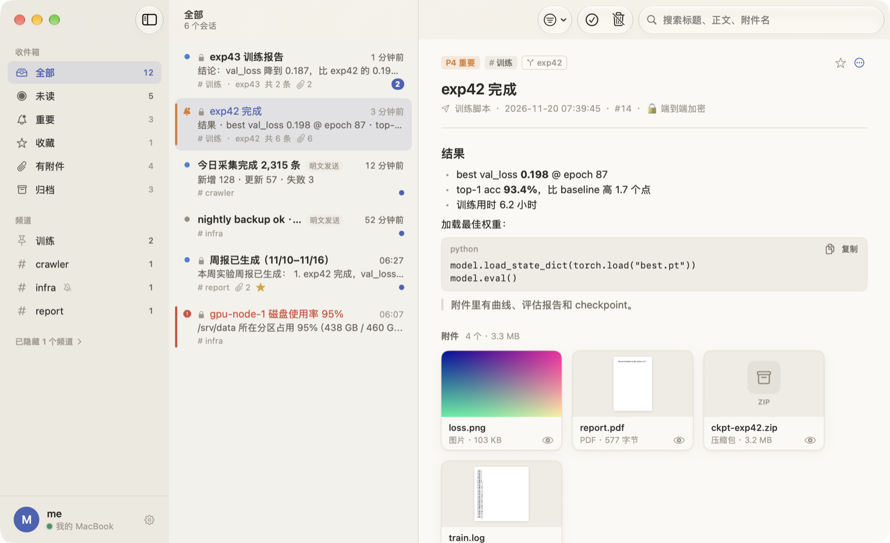
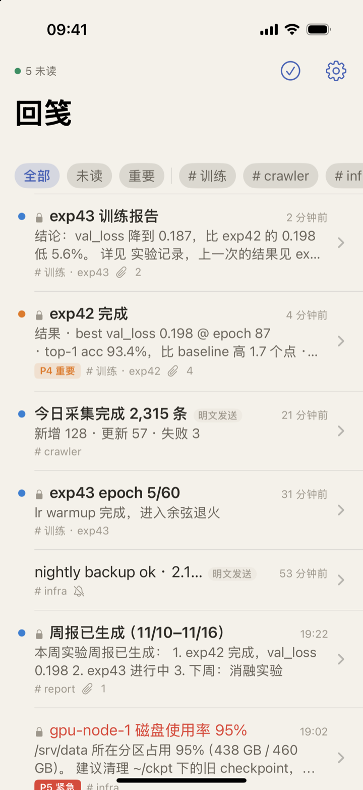
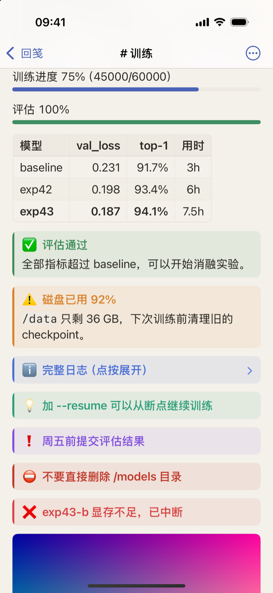
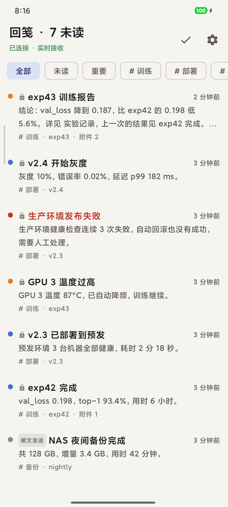
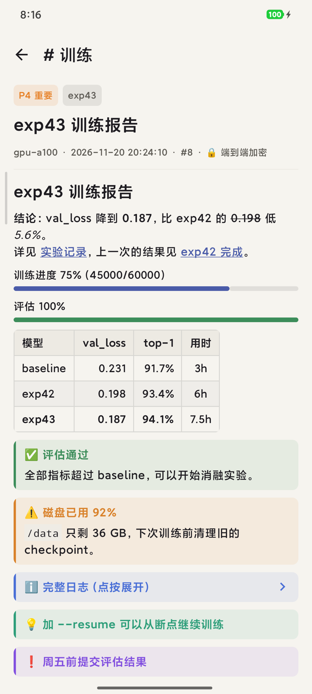

<div align="center">


# Huijian 回笺

**Lightweight, simple, end-to-end encrypted push notifications**

One line of curl delivers messages, images and files to your Mac, Android phone and iPhone.<br>
Only your devices can read them. The server can't.

[中文](README.md) · English

[Features](#features) · [Quick start](#quick-start) · [Sending messages](#sending-messages) · [Clients](#clients) · [Docs](#docs) · [License](#license)

<br>

<picture>
  <source media="(prefers-color-scheme: dark)" srcset="docs/screenshots/mac-main-dark.png">
  
</picture>

   

</div>

## Features

### 🪶 Lightweight

- The server is a single ~12 MB binary plus one SQLite file, using a few tens of MB of memory.
- It runs on a cloud VM, a Raspberry Pi, a NAS or a dev board. No database server, no domain name required.
- All three clients are native apps: Mac (SwiftUI), Android (Jetpack Compose), iPhone (SwiftUI).

### ✨ Simple

- **Send with one line**: PushDeer-compatible API. Existing scripts only need a new address.
  ```bash
  curl "https://push.example.com/message/push?pushkey=PK_xxx&text=Training%20done"
  ```
- **Know what matters**: six priority levels. Urgent messages ring even in silent or Do Not Disturb mode; routine logs go quietly into the list.
- **More than text**: send images, PDFs, spreadsheets and archives. Bodies support Markdown, with tables, progress bars and inline attachment images.
- **One thread per job**: messages from the same training run or deployment fold into a single timeline.
- **Channels**: sort messages by source. Rename, pin, mute or hide them; settings sync across all your devices.
- **Never lost, never duplicated**: failed sends are retried automatically, and retries never create duplicates.
- **Made for AI agents**: ships with a [skill file](skills/huijian/SKILL.md). Tell Claude Code or another agent "notify me when it's done".

### 🔐 Encrypted

- **End-to-end encryption, on by default**: turned on automatically when you register. Nothing to set up.
- **The server can't read your messages**: titles, bodies and attachments can only be opened by devices you have signed in on. The server, its database and its backups hold ciphertext only.
- **Two ways to send**:
  - **Encrypted send key**: encrypted on the sending machine, so the server never sees the content.
  - **Plain pushkey**: just use curl. These messages are marked "sent in plain text" on your devices: the server sees the content on arrival, then encrypts it immediately, so the database and backups still hold no plain text.
- **New devices just work**: sign in with your password and your earlier messages unlock automatically.
- **No impersonation**: when one of your devices approves another, both show a 6-digit code to compare.
- **Recovery**: set a recovery code to get your encrypted messages back if you forget your password and have no other device.

### 🛡️ Secure

- **The operator can't see you**: the admin console only manages accounts and shows aggregate numbers. It can't see anyone's messages, pushkeys or devices, and can't sign in to anyone's account.
- **The admin console is not exposed**: it can only be opened on the server itself. No account can open it from a client.
- **Invite-only sign-up**: registration requires an invite code by default.
- **Tamper-proof updates**: server and client updates are signature-checked.
- **Your data stays with you**: self-host it, back it up automatically, and move to a new server with one command.

## Quick start

You need one server with a public IP. No domain name required.

**1. On the server**

```bash
git clone https://github.com/HongYile/huijian.git
cd huijian/deploy/docker
cp .env.example .env                   # set HUIJIAN_PUBLIC_URL to http://YOUR_PUBLIC_IP:8790
docker compose up -d --build
docker exec huijian huijian invite new # create an invite code
```

Open port `8790` in your cloud provider's security group or firewall.

**2. Install a client and register**

- Download Huijian from [Releases](https://github.com/HongYile/huijian/releases) and enter the server address `YOUR_PUBLIC_IP:8790`.
- Register with the invite code. You are signed in right away, with encryption already on.
- Create a key under "Settings → Pushkey".

**3. Send a test message**

```bash
curl "http://YOUR_PUBLIC_IP:8790/message/push?pushkey=PK_xxx&text=hello"
```

> If you have a domain, set up HTTPS. Home server plus cloud relay, attachments and backups on a NAS, and how to open the admin console are covered in the [deployment guide](docs/deploy.md) (Chinese).

## Sending messages

```bash
# With priority, channel, thread and attachment
curl -F pushkey=PK_xxx -F text="exp42 done" -F desp="val_loss **0.231**" -F priority=4 \
     -F topic=train -F thread=exp42 -F file=@loss.png \
     http://1.2.3.4:8790/message/push
```

**Command line**: the server binary is also a client. Failed sends are retried automatically; with an encrypted send key, it encrypts on your machine.

```bash
export HUIJIAN_URL=http://1.2.3.4:8790
export HUIJIAN_PUSHKEY=PK_xxx.e2e.xxxx     # encrypted send key, copied from the client's Pushkey page
huijian push -p 4 -topic train -f loss.png "exp42 done"
```

**Python**: [`sdk/python/huijian.py`](sdk/python/huijian.py) is a single file. Copy it into your project.

```python
import huijian
huijian.push("exp42 done", "val_loss 0.231", files=["loss.png"], priority=4)

with huijian.run("exp42"):   # sends start / done (with duration) / error (urgent, with traceback)
    train()
```

Priorities, channels, Markdown syntax and the full API: [user guide](docs/guide.md), [Huijian Markdown](docs/markdown.md), [API reference](docs/api.md) (Chinese).

## Clients

| | Status | Install |
|---|---|---|
| **Mac** | Stable, lives in the menu bar | Download from Releases, drag into Applications |
| **Android** | Beta, no Google services needed | Download the apk from Releases |
| **iPhone** | Beta, lock-screen alerts delivered via Bark | Download the ipa from Releases and sideload with GBox or a similar tool |

- All three clients have the same features, and messages, channels and pushkey settings sync across devices.
- All three update in-app.
- See [android/README.md](android/README.md) and [ios/README.md](ios/README.md) for the mobile clients.

## Docs

The docs are currently in Chinese.

- [User guide](docs/guide.md): priorities, channels, threads, attachments, multiple devices
- [Deployment](docs/deploy.md): configuration, HTTPS, NAS, backup and migration, admin console, invite codes
- [End-to-end encryption](docs/e2ee.md): what is encrypted and how
- [API reference](docs/api.md), [Huijian Markdown](docs/markdown.md)
- [Architecture](docs/architecture.md), [UI design guidelines](docs/design.md)

## License

Copyright (C) 2026 HongYile

- **Server, admin console, Mac client**: [GNU AGPL v3](LICENSE). Individuals and companies may deploy and use it for themselves without restriction, and may modify it. If a modified version is offered to others over a network (including hosting it for others), the complete modified source must be made available to those users under AGPL section 13; redistribution must include the source and stay under the AGPL.
- **`sdk/` (Python SDK) and `skills/` (agent skill file)**: MIT ([sdk/LICENSE](sdk/LICENSE), [skills/LICENSE](skills/LICENSE)). Copy them into any project, including closed-source and commercial ones.
- Server 0.5.5, Mac client 0.5.6 and earlier releases were published under MIT and remain MIT. Later commits and releases are licensed as above.
- For use outside the AGPL (for example, closed-source modifications for commercial use), contact me on GitHub; commercial licenses are available.

**API use**: programs that only send or receive messages through Huijian's HTTP API (including the PushDeer-compatible API) are not derivative works of Huijian and are not bound by the AGPL. I will not assert any rights over them.

**Name and icon**: the names "回笺" and "Huijian" and the app icon are not licensed under the license. Modified redistributions must use a different name and icon to avoid confusion with the official version. Redistributing unmodified copies, or presenting the project in articles or videos, is not affected.

**Contributions**: by submitting a PR you confirm you have the right to submit it, and grant me a perpetual, irrevocable right to use, modify and relicense your contribution under the AGPL v3 or any other license (including commercial or closed-source licenses).
