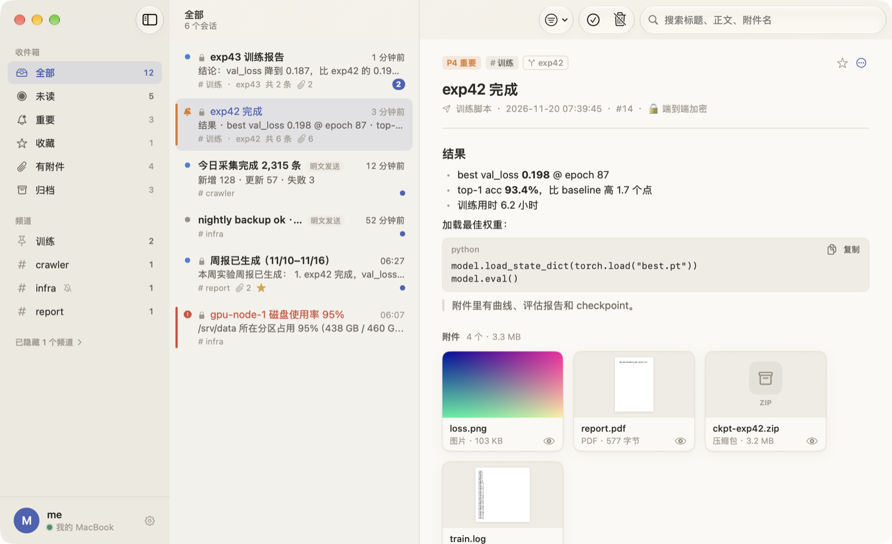
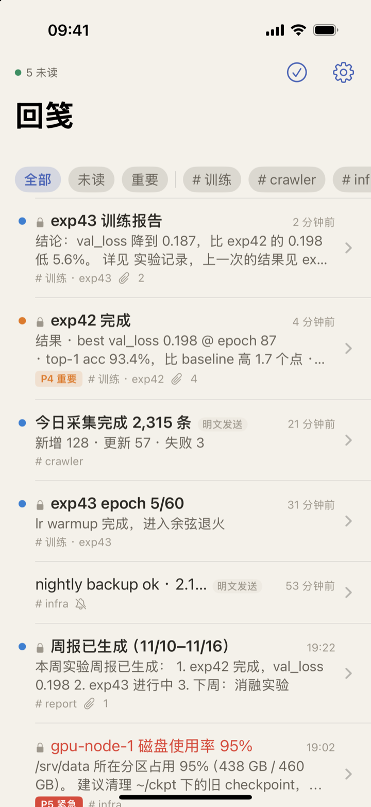
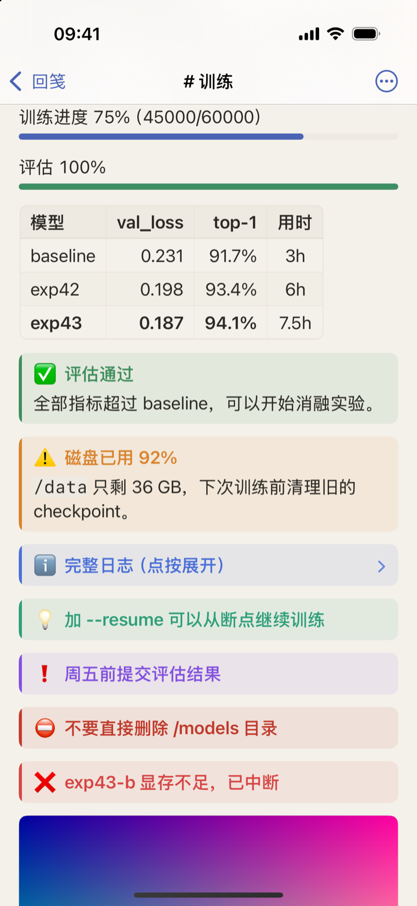
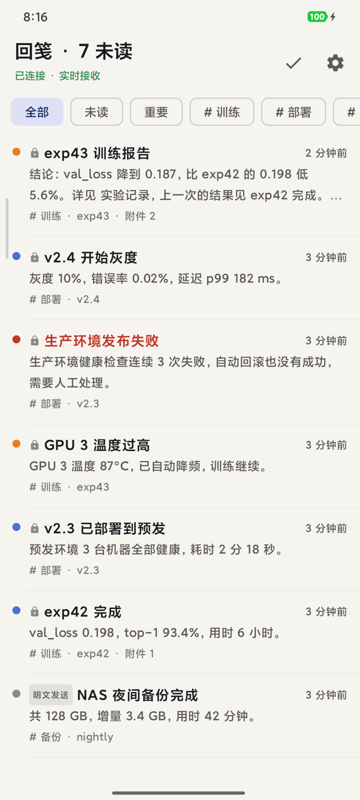
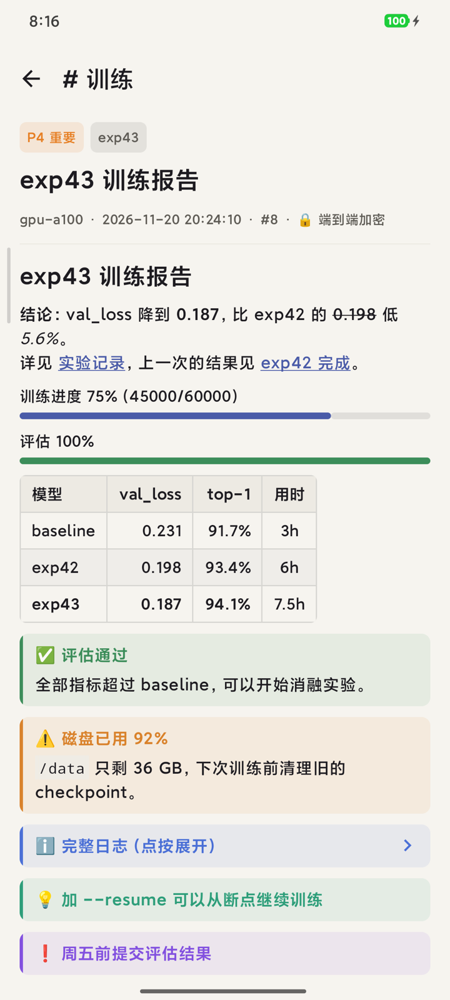

<div align="center">


# 回笺 Huijian

**轻量、简单、端到端加密的消息推送**

一行 curl 就能把消息、图片和文件送到你的 Mac、安卓和 iPhone。<br>
内容只有你的设备能解开，服务器看不到。

*一纸回笺：服务器、实验和脚本的消息，准时送到你手上。*

中文 · [English](README.en.md)

[特点](#特点) · [快速开始](#快速开始) · [发送消息](#发送消息) · [客户端](#客户端) · [文档](#文档) · [许可](#许可)

<br>

<picture>
  <source media="(prefers-color-scheme: dark)" srcset="docs/screenshots/mac-main-dark.png">
  
</picture>

   

</div>

## 特点

### 🪶 轻量

- 服务端是一个约 12MB 的程序，加一个 SQLite 文件，常驻内存几十 MB。
- 云服务器、树莓派、NAS、开发板都能跑。不需要数据库服务，也不需要域名。
- 三个客户端都是原生应用：Mac（SwiftUI）、安卓（Jetpack Compose）、iPhone（SwiftUI）。

### ✨ 简单

- **一行就能发**：兼容 PushDeer 的接口，旧脚本改个地址就能用。
  ```bash
  curl "https://push.example.com/message/push?pushkey=PK_xxx&text=训练完成"
  ```
- **分得清轻重**：六级优先级。紧急消息静音、勿扰时也会响；过程日志只进列表，不打扰你。
- **不只是文字**：图片、PDF、表格、压缩包都能发。正文支持 Markdown，可以放表格、进度条，也可以直接显示附件图片。
- **一件事一条线**：同一次训练或部署的多条消息，折叠成一条时间线。
- **频道**：按来源分类。可以改名、置顶、静音、隐藏，设置在所有设备之间同步。
- **不丢不重**：发送失败的消息会自动补发，重试也不会重复。
- **给 AI agent 用**：附带一份 [skill 文档](skills/huijian/SKILL.md)。对 Claude Code 等 agent 说一句「跑完通知我」就行。
- **agent 能问你、你能直接回**：agent 需要你拍板时，把问题发到手机上，你点快捷按钮或打字回复，agent 收到后接着干；回复送达后显示 ✓✓。支持命令行和 MCP，消息和回复都端到端加密，agent 每次登录都要你在设备上核对批准。

### 🔐 加密

- **端到端加密，默认开启**：注册时就自动开启，不用做任何设置。
- **服务器看不到内容**：消息的标题、正文和附件，只有你登录过的设备能解开。服务器、数据库和备份里只有密文。
- **两种发送方式**：
  - **加密发送密钥**：在发送的机器上加密，服务器全程看不到内容。
  - **普通 pushkey**：用 curl 直接发，简单。这类消息在你的设备上会标「明文发送」：服务器收到时能看到内容，但会立即加密保存，数据库和备份里同样没有明文。
- **新设备直接用**：用密码登录，就能自动解开以前的消息。
- **防冒充**：用另一台设备批准新设备时，两边要核对 6 位数字，防止有人冒充。
- **找回**：可以设恢复码。忘了密码、身边也没有别的设备时，用它找回加密消息。

### 🛡️ 安全

- **运营方看不到你**：管理后台只管账号和统计数字，看不到任何人的消息、pushkey 和设备，也不能登录进别人的账号。
- **后台不对外开放**：管理后台只能在服务器上进入。没有哪个账号能从客户端打开它。
- **邀请制注册**：默认凭邀请码注册。
- **更新防篡改**：服务端和客户端的更新都经过签名校验。
- **数据在自己手里**：可以自己部署，自动备份，一条命令迁移到新服务器。

## 快速开始

需要一台服务器，有公网 IP 就行，不需要域名。

**1. 服务器上**

```bash
git clone https://github.com/HongYile/huijian.git
cd huijian/deploy/docker
cp .env.example .env                   # 把 HUIJIAN_PUBLIC_URL 改成 http://你的公网IP:8790
docker compose up -d --build
docker exec huijian huijian invite new # 生成一个邀请码
```

在云服务器的安全组 / 防火墙里放行 `8790` 端口。

**2. 装客户端、注册**

- 从 [Releases](https://github.com/HongYile/huijian/releases) 下载回笺，填上服务器地址 `你的公网IP:8790`。
- 用邀请码注册，注册完就是登录状态，加密已经开启。
- 在「设置 → Pushkey」里新建一把 key。

**3. 发一条试试**

```bash
curl "http://你的公网IP:8790/message/push?pushkey=PK_xxx&text=hello"
```

> 有域名的话，建议配置 HTTPS。家里服务器加云服务器转发、附件和备份放 NAS、管理后台怎么进入，都写在[部署指南](docs/deploy.md)里。

## 发送消息

```bash
# 带优先级、频道、线程和附件
curl -F pushkey=PK_xxx -F text="exp42 完成" -F desp="val_loss **0.231**" -F priority=4 \
     -F topic=train -F thread=exp42 -F file=@loss.png \
     http://1.2.3.4:8790/message/push
```

**命令行**：服务端程序同时也是客户端。发送失败会自动补发；用加密发送密钥时，会在本机加密。

```bash
export HUIJIAN_URL=http://1.2.3.4:8790
export HUIJIAN_PUSHKEY=PK_xxx.e2e.xxxx     # 加密发送密钥，在客户端 Pushkey 页复制
huijian push -p 4 -topic train -f loss.png "exp42 完成"
```

**Python**：[`sdk/python/huijian.py`](sdk/python/huijian.py) 只有一个文件，复制进项目就能用。

```python
import huijian
huijian.push("exp42 完成", "val_loss 0.231", files=["loss.png"], priority=4)

with huijian.run("exp42"):   # 自动发送：开始 / 完成（含用时）/ 出错（紧急 + 报错信息）
    train()
```

**agent 提问、等你回复**（服务端 0.10.0 起）：在客户端「设置 → Pushkey」页的 Agent 部分新建 Agent key，agent 登录时在设备上核对 6 位核对码批准。

```bash
export HUIJIAN_AGENT_KEY=AK_xxx
huijian agent login -name "家里 Claude Code"          # 你在手机上点「批准」后显示核对码，核对一致再确认
huijian agent ask -choice 删 -choice 保留 "要不要删掉 3 个异常样本？"   # 回复打印到标准输出
claude mcp add huijian -- huijian mcp                 # 或者作为 MCP 工具：notify / ask / check_replies
```

设计和格式见 [agent 双向](docs/agent-mcp.md)。

优先级、频道、Markdown 写法和完整接口，见[使用指南](docs/guide.md)、[回笺 Markdown](docs/markdown.md) 和 [API 参考](docs/api.md)。

## 客户端

| | 状态 | 安装 |
|---|---|---|
| **Mac** | 正式版，常驻菜单栏 | Releases 下载，拖进「应用程序」 |
| **安卓** | 测试版，不依赖 Google 服务 | Releases 下载 apk |
| **iPhone** | 测试版，锁屏通知借助 Bark 送达 | Releases 下载 ipa，用 GBox 等工具自签安装 |

- 三端功能一致，消息、频道、Pushkey 的设置在所有设备之间同步。
- 都支持应用内更新。
- 安卓和 iPhone 的使用说明，见 [android/README.md](android/README.md) 和 [ios/README.md](ios/README.md)。

## 文档

- [使用指南](docs/guide.md)：优先级、频道、线程、附件、多设备
- [部署指南](docs/deploy.md)：配置、HTTPS、NAS、备份与迁移、管理后台、邀请码
- [端到端加密](docs/e2ee.md)：加密了什么、怎么做到的
- [API 参考](docs/api.md)、[回笺 Markdown](docs/markdown.md)
- [架构](docs/architecture.md)、[界面设计规范](docs/design.md)

## 许可

Copyright (C) 2026 HongYile

- **服务端、管理后台、Mac 客户端**：[GNU AGPL v3](LICENSE)。个人和公司自己部署、自己使用不受限制，也可以修改。修改后的版本如果通过网络给别人使用（包括托管给别人用），必须按 AGPL 第 13 条向这些用户提供修改后的完整源码；再发布时也要附带源码并保持 AGPL。
- **`sdk/`（Python SDK）和 `skills/`（agent skill 文档）**：MIT（[sdk/LICENSE](sdk/LICENSE)、[skills/LICENSE](skills/LICENSE)），可以直接复制进任何项目，包括闭源和商业项目。
- 已发布的服务端 0.5.5、Mac 客户端 0.5.6 及以前的版本以 MIT 发布，这些版本仍按 MIT 适用；之后的提交和版本按上面的方式授权。
- 想在 AGPL 之外使用（例如闭源修改后商用），请在 GitHub 上联系我，商业授权可以单独谈。

**接口调用**：只通过 HTTP 接口（包括 PushDeer 兼容接口）给回笺发消息、收消息的程序，不是回笺的衍生作品，不受 AGPL 约束，我不会就此主张任何权利。

**名称和图标**：「回笺」「Huijian」这两个名称和应用图标不随许可证授权。修改后再发布的版本请换用别的名称和图标，以免和官方版本混淆；原样转发，或在文章、视频里介绍本项目，不受这条限制。

**贡献代码**：提交 PR 即表示你保证有权提交这些内容，并授予我永久、不可撤销的权利，以 AGPL v3 或任何其他许可（包括商业、闭源许可）使用、修改、再许可你的贡献。
